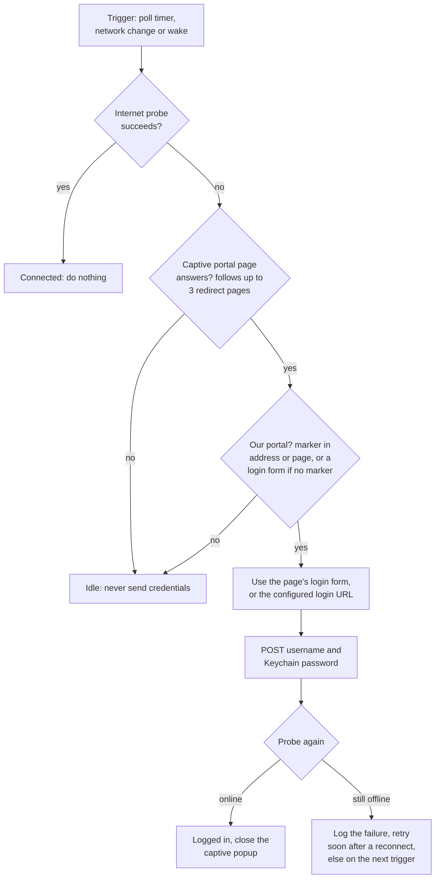
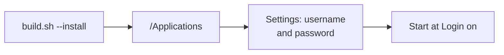

<h1 align="center">WiFi Butler</h1>

<p align="center">
  Keeps a Mac logged in to a captive-portal WiFi and shows network speed, usage, CPU and memory in the menu bar.
</p>

<p align="center">
  
  
  
  
  
  
</p>

Some WiFi networks (hotels, offices, campuses) log you out after sleep, roaming or a session timeout and ask you to
sign in again on a captive portal page. WiFi Butler notices and signs you back in within seconds, but only on the
network whose portal you configured.

## Features

- **Automatic sign-in.** Polling, network changes and wake from sleep all trigger a check. After a reconnect it
  retries every 3 s, up to 4 times, while the portal warms up, and after signing in it confirms internet access.
- **Safe by design.** Credentials are posted only when your portal answers. On any other network, or while offline,
  it stays idle.
- **Finds the form itself.** It reads the portal's login form, following up to three redirect pages (meta refresh or
  JavaScript), so most portals need only a username and password.
- **Menu-bar meters.** Live upload and download speed, today's usage, a 30-day usage history, and optional CPU and
  memory.
- **Keychain.** The password lives in the macOS Keychain, never in a file.
- **Two ways to run.** A native menu-bar app (`macos-app/`) for everyday use, or a `bash` + `curl` script with a
  launchd agent for headless setups and portal discovery.

## How it works



The portal-presence check is the safety rule. The CLI runs the same check against the configured portal host instead
of following the captive redirect.

## Getting started

Requirements: macOS 26 or later; the Xcode Command Line Tools for the app (no Xcode project needed).

**Menu-bar app**

```sh
cd macos-app
./build.sh
open "build/WiFi Butler.app"
```

Open the menu-bar bolt icon, choose **Settings…** and enter the username and password. The advanced fields (login
URL, extra form fields, portal marker) are only fallbacks. More in [`macos-app/README.md`](macos-app/README.md).

**CLI**

While connected to the WiFi but signed out of the portal:

```sh
./discover-portal.sh                          # prints the portal's form action and hidden fields
cp config.example config && chmod 600 config  # then fill it in
./keychain-setup.sh                           # moves the password into the Keychain
./wifi-autologin.sh --once                    # one test run
```

## Configuration

The app keeps everything in its **Settings…** window: the password in the Keychain, the rest in the user defaults.

The CLI reads `config`, copied from [`config.example`](config.example), which explains every line. It holds the
portal address and login URL (from `discover-portal.sh`), an optional portal marker word, the username, the Keychain
item name, any extra form fields and the check interval. `config` is git-ignored and holds no secret once
`keychain-setup.sh` has run.

## Scripts

| Command | What it does |
| --- | --- |
| `macos-app/build.sh` | Builds `build/WiFi Butler.app` and a `.dmg`; `--no-dmg` skips the image, `--install` copies the app to `/Applications` |
| `macos-app/Tests/run.sh` | Unit tests |
| `discover-portal.sh` | Reads the portal's real login form |
| `keychain-setup.sh` | Stores the password in the Keychain |
| `wifi-autologin.sh` | The CLI monitor; `--once` runs one check |
| `install.sh` / `uninstall.sh` | Loads or unloads the launchd agent (`com.davidwidagdo.wifi-autologin.plist`) |

## Install



- **App:** `macos-app/build.sh --no-dmg --install`, then turn on **Start at Login** from the menu. The app is
  ad-hoc signed, so after each rebuild allow Keychain access once and toggle Start at Login again. Sharing it with
  other Macs needs signing and notarization.
- **CLI:** `./install.sh` starts the agent now, at every login, and restarts it if it stops. Check it with
  `launchctl list | grep wifi-autologin` and `tail -f ~/Library/Logs/wifi-autologin.log`. To remove it, run
  `./uninstall.sh` and delete the Keychain item with
  `security delete-generic-password -a "<your-username>" -s "wifi-autologin"`.

## Notes

- **MikroTik CHAP portals.** If `discover-portal.sh` reports a `challenge` or `chap-id` field, the portal hashes the
  password as `md5(chap-id + password + challenge)`, which the login does not support yet.
- **The macOS captive popup.** The app closes it once internet is confirmed; if login fails it stays open as the
  manual fallback. For the CLI you can turn the popup off (needs sudo, and only once login works):
  `sudo defaults write /Library/Preferences/SystemConfiguration/com.apple.captive.control Active -bool false`.

## License

[MIT](LICENSE)
